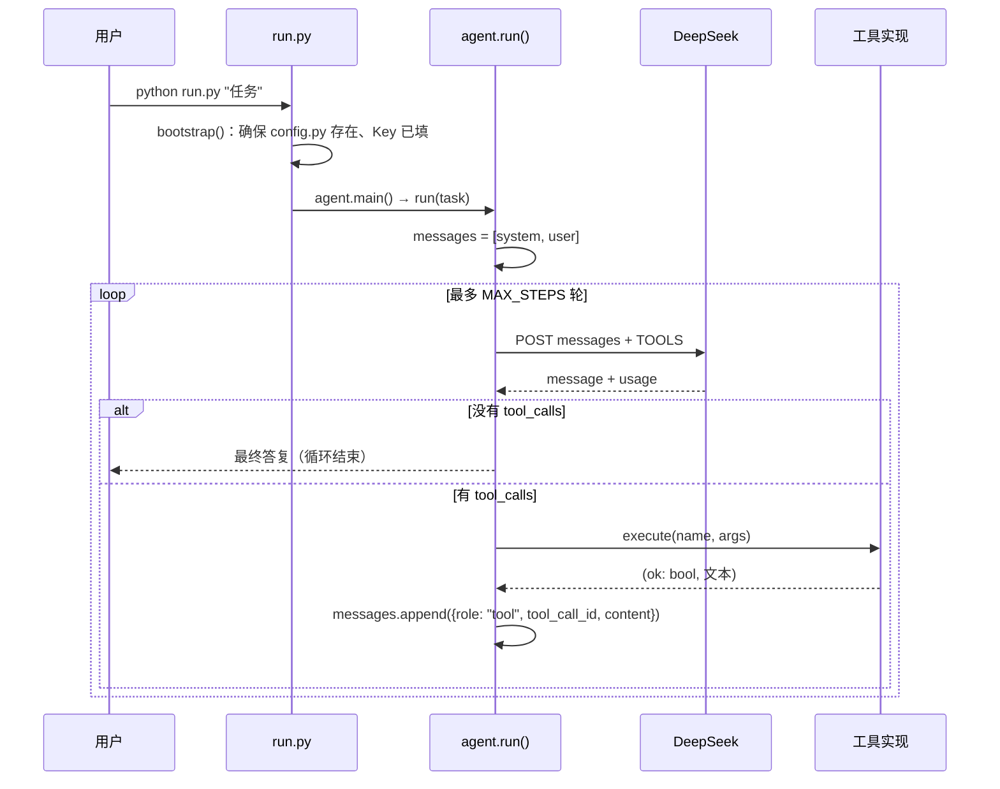
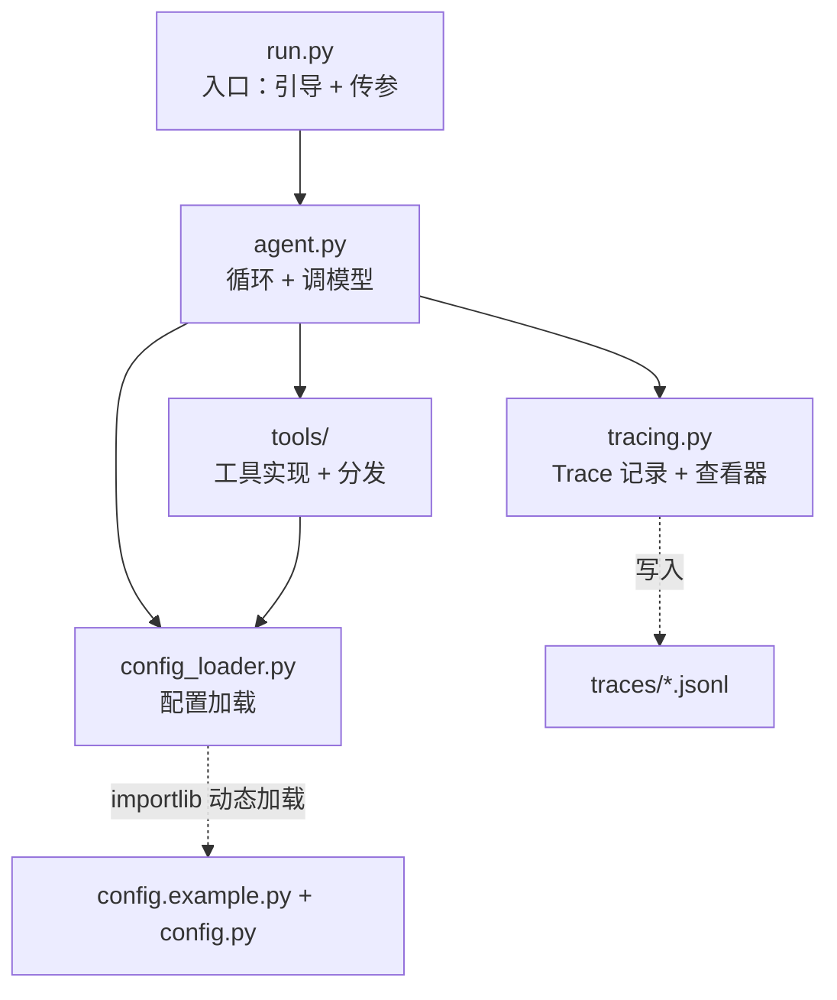

# 架构快照

这份文档描述**当前**的结构。每次结构性改动（新模块、职责转移、循环变化）都更新它，
避免过一阵子回来看不懂自己写了什么。历史版本看 `git log ARCHITECTURE.md`。

---

## 一句话

一个 `while` 循环：每轮把「消息历史 + 工具清单」发给模型，
模型要么返回工具调用，要么返回最终答复。除此之外没有别的机制。

---

## 1. 一次运行的时序



---

## 2. 消息结构 —— agent 的全部状态

目前没有别的状态，`messages` 就是一切：

```python
messages = [
    {"role": "system",    "content": "<SYSTEM_PROMPT>"},

    {"role": "user",      "content": "<任务>"},

    {"role": "assistant", "content": "", "tool_calls": [
        {"id": "call_1", "type": "function",
         "function": {"name": "list_dir", "arguments": "{\"path\":\".\"}"}}]},

    {"role": "tool",      "tool_call_id": "call_1", "content": "<工具输出>"},

    {"role": "assistant", "content": "以下是结论……"},   # 没有 tool_calls = 结束
]
```

三个要点：

- **只增不减**。上下文管理要解决的正是这个列表的膨胀。
- **`tool_call_id` 必须一一对应**。少一条、错一个 id，下一轮 API 直接报错。
- **顺序即语义**。谁在谁之后决定了模型看到什么，不能随意调整。

---

## 3. 模块与依赖



| 文件 | 职责 | 行数 |
|---|---|---|
| `run.py` | 首次配置引导、参数转发 | 88 |
| `agent.py` | 循环、调模型 | 230 |
| `config_loader.py` | 配置加载、运行参数 | 56 |
| `tools/__init__.py` | 工具声明 + 分发 | 104 |
| `tools/base.py` | 错误类型、路径约束、截断 | 34 |
| `tools/files.py` | 看目录 / 读 / 写 | 33 |
| `tools/shell.py` | 执行命令 | 16 |
| `tracing.py` | `Trace` 类、查看器 CLI | 169 |
| `config.example.py` | 配置默认值 | 23 |

`tools/` 是唯一预期会持续变大的部分；其余模块按职责稳定。

> 为什么 `config_loader.py` 必须独立：`tools/` 需要 `WORKROOT`、`MAX_OUTPUT`，
> 如果它反过来 import `agent`，就会形成 `agent → tools → agent` 的循环依赖。

---

## 4. 谁决定什么

这是整个设计里最重要的一张表。

| 决策 | 谁决定 | 落在哪 |
|---|---|---|
| 要不要调工具 | 模型 | 返回的 `tool_calls` 空不空 |
| 调哪个工具 | 模型 | `function.name` |
| 参数填什么 | 模型 | `function.arguments`（JSON 字符串） |
| 一次调几个 | 模型 | `tool_calls` 数组长度 |
| 工具真的执行吗 | **宿主** | `tools/__init__.py::execute()` |
| 参数合法吗 | **宿主** | `json.loads` + `TypeError` 兜底 |
| 路径越界吗 | **宿主** | `_resolve()` 限制在 `WORKROOT` |
| 结果怎么回传 | **宿主** | `_clip()` 截断后塞进 `role=tool` |
| 什么时候停 | **宿主** | 无 `tool_calls` 或 `MAX_STEPS` |
| 记录了些什么 | **宿主** | `tracing.Trace` |

一句话：**模型只提建议，执行权在宿主。**

---

## 5. 配置的流向

```
config.example.py  ──默认值──┐
                             ├─► CFG ─► API_KEY / MODEL / MAX_STEPS ...
config.py（可选，覆盖）──────┘

环境变量 DEEPSEEK_API_KEY ──优先级最高，直接盖掉 API_KEY
```

- `config.py` 在 `.gitignore` 里，永远不入库。
- 用户只需要写想改的字段，漏掉的自动回退到示例值。
- 首次运行由 `run.py::bootstrap()` 生成该文件并询问 Key。

---

## 6. 不变式 —— 改代码时不能破坏的

1. **每个 `tool_call` 都必须有一条对应的 `role=tool` 消息**，`id` 一致。
   漏一条，下一轮请求会被 API 拒绝。
2. **循环必须能终止**：要么模型不再调工具，要么撞上 `MAX_STEPS`。
3. **模型输出一律不可信**：路径过 `_resolve()`，参数过 `json.loads()`，
   未知工具名返回错误而不是抛异常。
4. **工具失败不中断任务**：异常在这里被转成字符串回给模型，让它自己改。
5. **trace 是旁路**：它不应该改变控制流。目前 `Trace.emit()` 若抛异常
   会中断任务，这是个待修的点。

---

## 7. 边界与已知缺口

| 边界 | 现状 |
|---|---|
| 文件系统 | `WORKROOT` + `_resolve()` 阻挡路径穿越 |
| 命令执行 | **无限制** —— `run_shell` 可以绕过前两条限制 |
| 工具集 | 固定 4 个，不区分阶段 |
| 上下文 | 只增不减，只有 `MAX_OUTPUT` 截断单次工具输出 |
| 鉴权 | 明文 Key 在本地文件或环境变量中 |
| 并发 | 不支持，单任务串行 |

---

## 8. 扩展锚点

结构上预留的位置，后续功能往这里接：

| 要加的能力 | 接到哪 |
|---|---|
| 阶段化工具集 | `run()` 里换 `tools` 参数 |
| 前置条件校验 | `tools/__init__.py::execute()` 前后 |
| 上下文压缩 | `chat()` 调用前裁剪 `messages` |
| 中断恢复 | 序列化 `messages` + 阶段状态 |
| 权限审批 | `execute()` 内部 |
| 评估集 | 围绕 `run()` 包一层断言 |

---

最后更新：见 `git log -1 --format=%ad --date=short -- ARCHITECTURE.md`
